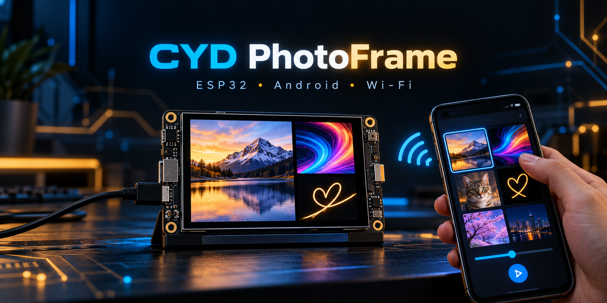

# CYD PhotoFrame

### Превратите маленький сенсорный ESP32-экран в беспроводную фоторамку и LIVE-холст.

[English](README.md) · **Русский** · **[Скачать APK](https://github.com/BAZUKA74/cyd-photo-frame/releases/latest)**

---

## Что умеет проект

CYD PhotoFrame напрямую соединяет Android-телефон с **ESP32-2432S028 / HW-458** по Wi-Fi. Телефон подготавливает файлы под ограниченную память платы, загружает их и позволяет рисовать на дисплее в реальном времени.

| Медиа и воспроизведение | Рисование и управление | Возможности устройства |
|---|---|---|
| Импорт фото, GIF и MP4 | Плавная LIVE-кисть по Wi-Fi | Сенсорное меню |
| Автоматическое преобразование в 320×240 | Линии, прямоугольники, круги и треугольники | Поворот и режимы заполнения экрана |
| Компактная оптимизация GIF | Контурные и залитые фигуры | Ручная и автоматическая яркость |
| Растягивание, обрезка и вписывание | Перемещаемый текст и его анимация | Русский и английский интерфейс |
| Хранение фотографий на плате | Экспорт картинки или анимации холста | Проверка обновлений через GitHub Releases |

## Быстрый старт

1. Скачайте и установите **[последний Android APK](https://github.com/BAZUKA74/cyd-photo-frame/releases/latest)**.
2. Включите ESP32 и подключите телефон к сети Wi-Fi `CYD-PhotoFrame`.
3. Откройте приложение и выберите фото, GIF, MP4 или редактор рисования.
4. Настройте поворот и заполнение экрана, затем нажмите **Подготовить и отправить**.

> [!TIP]
> При первом запуске приложение выбирает русский или английский по языку телефона. Язык можно переключить вручную через чёрное меню приложения.

## LIVE-рисование

Рисуйте на телефоне и сразу наблюдайте результат на дисплее ESP32. В редакторе доступны:

- плавная кисть с выбором толщины и цвета;
- прямые линии, прямоугольники, круги и треугольники;
- контурная или сплошная цветная заливка;
- перемещаемый и изменяемый по размеру текст;
- экспорт обычной картинки или анимированного GIF;
- повторная передача LIVE-пакетов для уменьшения разрывов при нестабильном Wi-Fi.

## Поддерживаемое оборудование

Готовые файлы прошивки предназначены для следующей конфигурации:

| Компонент | Поддерживаемая конфигурация |
|---|---|
| Плата | ESP32-2432S028 / HW-458 |
| Дисплей | 2,8 дюйма, 320×240 |
| ESP-модуль | ESP32 класса N4, 4 МБ Flash |
| Подключение | Прямая точка доступа Wi-Fi |
| Android | Android 5.0 и новее |

> [!CAUTION]
> У внешне похожих плат могут отличаться контроллер дисплея, распиновка, тачскрин, схема подсветки и разметка Flash. **Не прошивайте готовый BIN в другую модель вслепую.** Прочитайте [ADAPTATION_RU.md](ADAPTATION_RU.md) и соберите отдельную прошивку под свою плату.

## Загрузки

Все актуальные файлы находятся в разделе **[GitHub Releases](https://github.com/BAZUKA74/cyd-photo-frame/releases/latest)**:

- подписанный универсальный APK для Android;
- прошивка только программного раздела ESP32;
- полный образ Flash для ESP32;
- полный архив исходников приложения и прошивки.

Приложение умеет проверять GitHub Releases на наличие обновлений через чёрное меню.

## Каналы версий

| Версия | Канал | Что это означает |
|---|---|---|
| `v1.0`–`v1.99` | **BETA** | Активная разработка и тестирование. Функции ещё могут меняться или содержать ошибки. |
| `v2.0` и новее | **STABLE** | Основной функционал проверен и готов для обычного использования. |

Релизы ветки v1.x отмечаются на GitHub как **Pre-release**. Тег остаётся числовым, например `v1.15`, чтобы не ломать встроенную проверку обновлений.

## Исходный код

- `android/` — исходный код Android-приложения;
- `firmware/` — проект прошивки PlatformIO;
- [ADAPTATION_RU.md](ADAPTATION_RU.md) — инструкция по переносу на другие ESP32-платы;
- [README.md](README.md) — документация на английском языке;
- `CYD-PhotoFrame-v1.10-source.zip` — полный архив опубликованных исходников.

Закрытый ключ подписи Android намеренно не публикуется. Храните исходный ключ в безопасном месте: Android принимает обновление только тогда, когда новый APK подписан тем же ключом, что и установленное приложение.

## Безопасность

- Перед экспериментами сохраните полный заводской дамп Flash.
- Перед прошивкой проверьте точную версию платы и распиновку.
- Отключайте аккумулятор во время пайки и изменения проводки.
- Не подключайте голый Li-ion/LiPo аккумулятор напрямую, если нет подходящего контроллера зарядки и защиты.

## Участие в проекте

Сообщения об ошибках, информация о переносе на другие платы и улучшения приветствуются. Если нужна поддержка другой платы, приложите чёткие фотографии обеих сторон, полную маркировку, модели контроллеров, распиновку, объём Flash/PSRAM и лог сборки или загрузки.

Для маленьких экранов, ярких пикселей и неожиданно мощных фоторамок.

